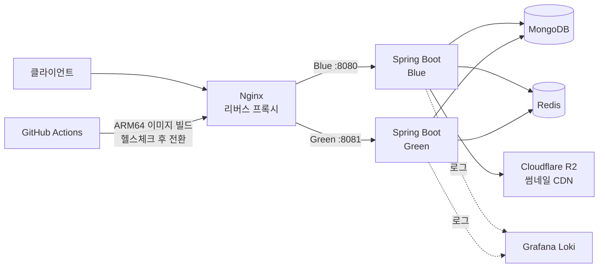

# 라이트(Laiteu) 백엔드 — 성능·운영 케이스 스터디

웹툰 작가를 위한 포트폴리오 서비스 [라이트](https://laiteu.com)의 백엔드를 2023년 11월부터
2026년 10월까지 단독으로 설계·개발·운영하며 마주친 문제들을 정리한 문서입니다.

원본 저장소(`pack-in/laiteu-be`)는 운영 중인 서비스라 비공개입니다. 이 저장소는 그중
**문제 → 원인 → 해결 → 결과**가 수치로 남은 사례만 골라 공개한 기록입니다.

> 코드가 아니라 판단 근거를 남기는 것이 목적입니다. 각 문서는 "무엇을 고쳤다"가 아니라
> "무엇을 측정했고, 왜 그 원인이라고 판단했으며, 개선을 어떻게 검증했는가" 순서로 씁니다.

---

## 서비스 개요

| 항목 | 내용 |
|---|---|
| 기간 | 2023.11 ~ 2026.10 (2년 11개월) |
| 역할 | 백엔드 단독 담당 (API · 인증/인가 · 이미지 처리 · 배포 · 로그 모니터링) |
| 규모 | 누적 가입자 1,094명, 공개 작품 615건, peak TPS 10(부하테스트 가정), 도메인 모듈 18개 |
| 커밋 / PR | 914 / 129 (100% 단독 작성) |

**기술 스택**
Java 17 · Spring Boot 3.0.9 · Spring Security · Spring Data MongoDB · Redis · MapStruct · JJWT
· Docker · Nginx · AWS EC2(Graviton/ARM64) · Cloudflare R2 · Grafana Loki · k6

## 아키텍처

단일 EC2 인스턴스에서 Blue/Green 두 컨테이너를 띄우고 Nginx가 트래픽을 전환합니다.
서버가 한 대뿐이라 롤링 업데이트 대신 포트 전환 방식을 택했습니다 — 자세한 배경은
[03. 무중단 배포](docs/03-blue-green-무중단-배포.md)에 있습니다.

---

## 케이스

| # | 문제 | 결과 |
|---|---|---|
| [01](docs/01-북마크-폴더-조회-성능.md) | 북마크 폴더 조회 API가 7초 걸린다 | **7,031ms → 138ms** (3단계 개선, covered query 달성) |
| [02](docs/02-커뮤니티-피드-인덱스-설계.md) | 커뮤니티 피드 p95가 7초, 인메모리 정렬 발생 | **인덱스 스캔 문서 1,777건 → 30건** (98% 감소) |
| [03](docs/03-blue-green-무중단-배포.md) | 배포할 때마다 20~25초 다운타임 (월 최대 8분) | **다운타임 0초**, 헬스체크 실패 시 자동 롤백 |
| [04](docs/04-소셜로그인-레이스컨디션.md) | 동시 로그인 요청으로 계정이 중복 생성된다 | 사용자 문의로 발견한 중복 13건, JVM 락으로 직렬화 후 재발 없음 |

모든 수치는 각 문서 첫머리에 **측정 조건(데이터 건수, 인스턴스 타입, 측정 도구)** 을
명시해 두었습니다. 같은 기능이라도 조건이 다르면 수치가 달라지기 때문입니다.

---

## 이 저장소를 쓰며 지킨 원칙

1. **감이 아니라 계측으로 판단한다.** 모든 개선은 `StopWatch`, MongoDB `explain()`, k6 중
   하나 이상의 측정값을 근거로 합니다. "느린 것 같다"로 시작한 작업은 문서에 넣지 않았습니다.
2. **개선 전 수치와 개선 후 수치를 같은 조건에서 잰다.** 데이터 건수, 인스턴스 타입,
   측정 도구를 각 문서에 명시했습니다.
3. **실패하거나 되돌린 시도도 남긴다.** 한 번에 맞춘 것처럼 쓰지 않았습니다.

---

## 관련 링크

- 기술 블로그: https://danhandev.tistory.com
- 프로필: https://github.com/danhandev
