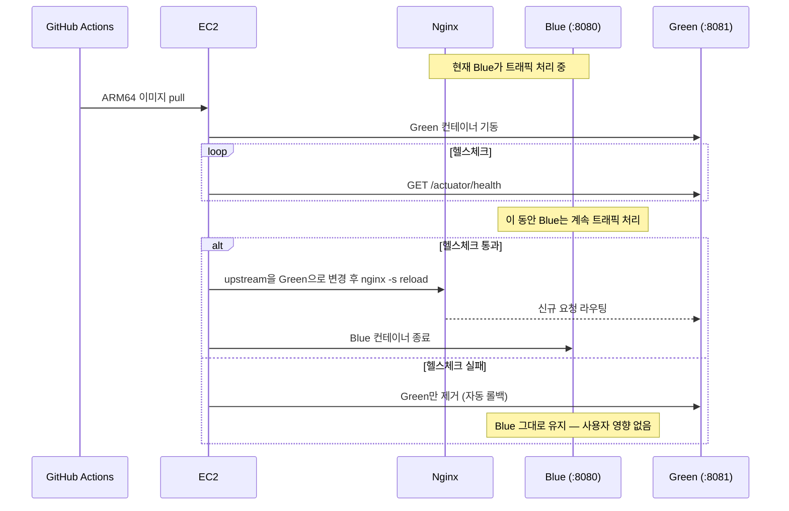

# 03. 무중단 배포 — 다운타임 20~25초 → 0초

> 환경: EC2 단일 인스턴스(ARM64 / Graviton), Docker, Nginx, GitHub Actions.

## 문제

배포 방식이 Docker Compose의 Recreate였습니다. 기존 컨테이너를 내리고 새 컨테이너를
올리는 방식이라, 그 사이 요청이 전부 502로 떨어졌습니다.

- 배포 1회당 다운타임 **평균 20~25초**
- 배포 빈도를 감안하면 **월 최대 8분**
- 배포가 실패하면 수동으로 이전 이미지를 다시 올려야 함

배포가 무서우니 배포를 미루게 되고, 그러면 한 번에 나가는 변경이 커져서 더 위험해지는
악순환이 있었습니다.

## 왜 롤링 업데이트가 아니라 Blue-Green인가

서버가 **한 대**입니다. 인스턴스를 여러 대 두고 순차 교체하는 롤링 업데이트는
전제 자체가 성립하지 않았습니다. 대신 같은 서버 안에서 포트를 두 개 쓰기로 했습니다.



핵심은 **`nginx -s reload`가 graceful하다**는 점입니다. reload는 기존 워커가 처리 중인
연결을 끊지 않고 끝까지 처리하게 둔 뒤 새 워커로 교체합니다. 그래서 전환 순간에도
끊기는 요청이 없습니다.

## 구현하며 막힌 것 — 아키텍처 불일치

첫 배포에서 컨테이너가 `exec format error`로 죽었습니다.

- EC2 인스턴스: **ARM64** (Graviton, 비용 때문에 선택)
- GitHub Actions 러너: **amd64**

러너에서 그냥 빌드하면 amd64 이미지가 나오고, ARM64 서버에서는 실행되지 않습니다.
`docker/build-push-action`에 `platforms: linux/arm64`를 지정해 크로스 컴파일로 해결했습니다.

```yaml
- uses: docker/build-push-action@v5
  with:
    platforms: linux/arm64
    push: true
```

## 결과

| 항목 | 개선 전 | 개선 후 |
|---|---|---|
| 배포 시 다운타임 | 20~25초 (월 최대 8분) | **0초** |
| 배포 실패 시 | 수동 복구 | 헬스체크 실패 시 **자동 롤백** |
| 배포 결과 확인 | 직접 확인 | Discord 알림 연동 |

## 배운 것

- **인프라 제약이 설계를 결정한다.** "무중단 배포 = 롤링 업데이트"로 외우고 있었다면
  서버 한 대에서는 못 한다고 결론 내렸을 것입니다. 무중단의 조건이
  "**전환 순간에 요청을 받아줄 프로세스가 있을 것**"이라는 점으로 돌아가니
  단일 서버에서도 방법이 있었습니다.
- **헬스체크가 통과하기 전까지 기존 버전이 트래픽을 계속 받는 구조**가 자동 롤백의 전제입니다.
  전환을 먼저 하고 검증을 나중에 하면 롤백할 시점에는 이미 장애입니다.
- 빌드 환경과 실행 환경의 CPU 아키텍처는 명시적으로 맞춰야 합니다. 로컬과 CI와 서버가
  전부 다를 수 있습니다.
