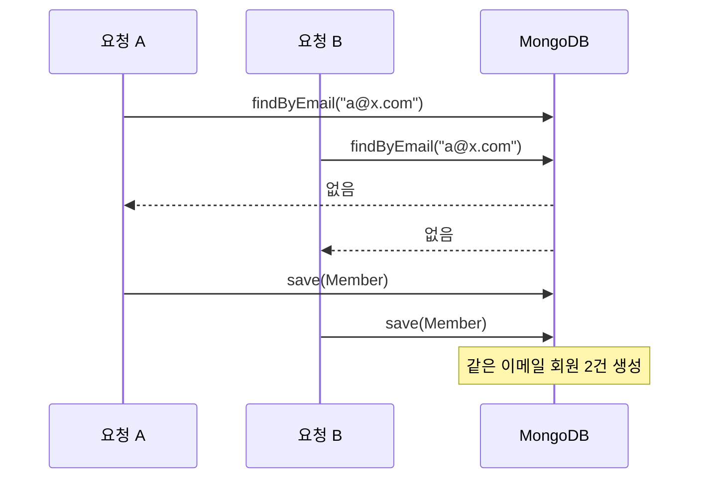

# 04. 소셜 로그인 계정 중복 생성 — 레이스 컨디션

> 환경: 단일 애플리케이션 인스턴스, Firebase Authentication + 자체 JWT, MongoDB.

## 문제

"계정이 두 개 생겼다"는 사용자 문의를 받고 데이터를 확인하면서 발견했습니다. 같은 이메일로
회원이 두 건 생성되어 있었고, 같은 패턴으로 만들어진 중복이 전체 **13건**이었습니다.
API는 200을 반환했고 에러 로그도 없었습니다. 응답만 보면 정상이었지만 데이터 상태는
의도와 달랐습니다. 모니터링으로는 잡히지 않고 사용자가 알려줘야 드러나는 종류의 문제였습니다.

원인은 Firebase 소셜 로그인 핸들러의 구조였습니다.

```java
public LoginResponse login(String idToken) {
    FirebaseToken decoded = firebaseAuth.verifyIdToken(idToken);
    String email = decoded.getEmail();

    Member member = memberRepository.findByEmail(email)     // ① 조회
        .orElseGet(() -> memberRepository.save(             // ② 없으면 생성
            Member.fromFirebase(decoded)));

    return jwtProvider.issue(member);                       // ③ 발급
}
```

①과 ② 사이에 틈이 있습니다. 클라이언트가 로그인 버튼 더블클릭이나 재시도로 요청을
두 번 보내면, 두 요청이 모두 ①에서 "없음"을 확인한 뒤 각자 ②를 실행합니다.
전형적인 **check-then-act(TOCTOU)** 문제입니다.



## 재현

가설로 끝내지 않고 재현 테스트를 먼저 작성했습니다. `CountDownLatch`로 동시 요청
N건을 같은 순간에 출발시켜, 수정 전에는 실패하고 수정 후에는 통과하는 테스트를 만들었습니다.

## 해결 — 왜 Redis를 쓰지 않았는가

선택지가 셋 있었습니다.

| 방안 | 판단 |
|---|---|
| MongoDB unique index | 가장 견고하지만, 이미 들어간 중복 데이터를 먼저 정리해야 인덱스가 생성됨. 운영 중이라 즉시 적용 불가 |
| Redis 분산 락 | 다중 인스턴스까지 커버하지만, 이 시점 배포는 **단일 인스턴스**. 이 문제 하나 때문에 Redis 의존을 새로 만드는 건 과합니다 |
| JVM 메모리 락 | 단일 인스턴스 전제에서 충분. 추가 인프라 0 |

**단일 인스턴스라는 현재 조건**에 맞춰 JVM 락을 택했습니다. 이메일 단위로 락을 잡아
조회 → 생성 → JWT 발급 전 구간을 직렬화했습니다.

```java
private final ConcurrentHashMap<String, Object> locks = new ConcurrentHashMap<>();

public LoginResponse login(String idToken) {
    FirebaseToken decoded = firebaseAuth.verifyIdToken(idToken);
    String email = decoded.getEmail();

    Object lock = locks.computeIfAbsent(email, k -> new Object());
    synchronized (lock) {
        Member member = memberRepository.findByEmail(email)
            .orElseGet(() -> memberRepository.save(Member.fromFirebase(decoded)));
        return jwtProvider.issue(member);
    }
}
```

락 대상을 서비스 전체가 아니라 **이메일 단위**로 좁힌 것이 핵심입니다. 서로 다른
사용자의 로그인은 여전히 병렬로 처리됩니다.

## 결과

- 재현 테스트 통과, 이후 같은 원인의 중복 계정 생성 없음
- 추가 인프라 도입 없음
- 다른 사용자 간 로그인 처리량 영향 없음

## 남은 한계 — 알고 감수한 것

이 해결책은 **단일 인스턴스에서만 유효**합니다. 서버를 여러 대로 늘리는 순간
JVM 락은 각 인스턴스 안에서만 동작하므로 다시 깨집니다. 이 점은 코드 주석에 명시하고,
증설 시 할 일을 다음 순서로 정리해두었습니다.

1. 기존 중복 데이터 정리
2. `email` unique index 생성 (DB 레벨의 최종 방어선)
3. 필요 시 Redis 분산 락으로 교체

## 배운 것

- **API가 200을 반환해도 데이터 상태는 의도와 다를 수 있다.** 응답만 보는 테스트로는
  이 버그를 잡을 수 없었습니다. 이후 동시성이 관여하는 구간은 `CountDownLatch` 재현
  테스트를 먼저 쓰는 것을 기본으로 삼았습니다.
- **현재 인프라 조건에 맞는 최소한의 해결을 택하되, 그 전제가 깨지는 시점을 문서로 남긴다.**
  "언젠가 확장할지 모르니 Redis부터 넣자"는 지금 필요 없는 복잡도이고,
  "JVM 락으로 해결했다"만 남기면 증설할 때 아무도 모릅니다.
